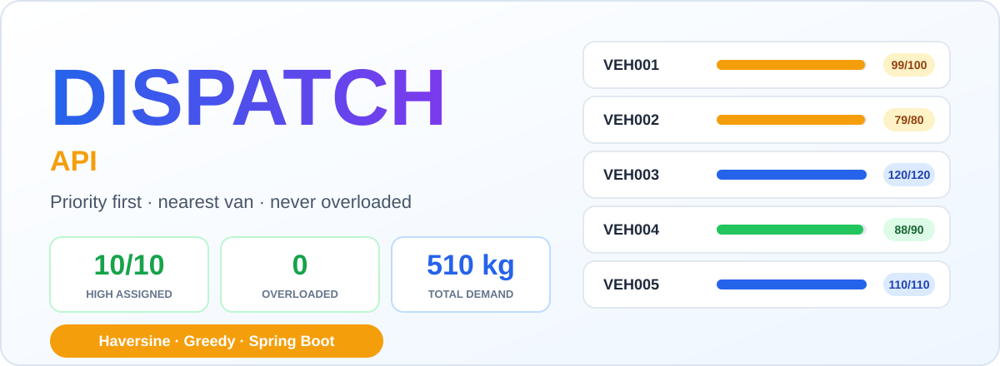
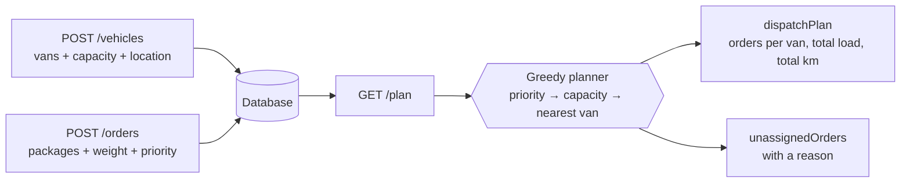
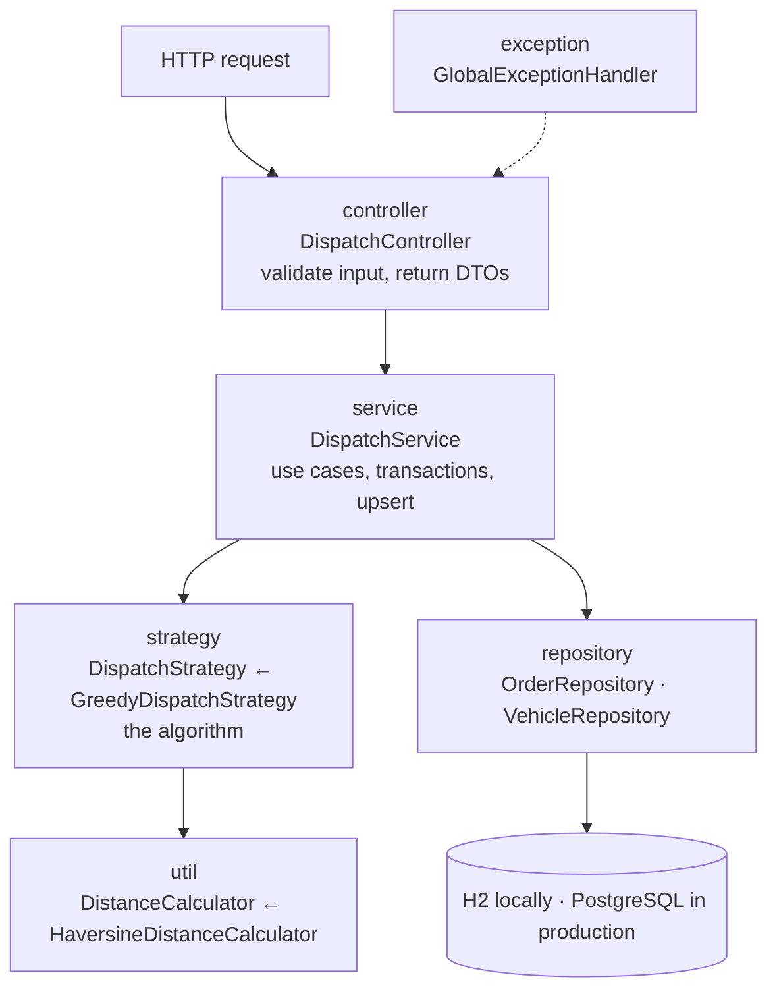

<div align="center">



<br/>

<a href="#api"></a>
<a href="#testing"></a>


<br/><br/>

Assigns delivery orders to a fleet of vehicles:<br/>
**HIGH priority first**, **capacity never exceeded**, **nearest vehicle** by Haversine distance,<br/>
and every order that cannot fit is reported with a reason.

<br/>

[What it does](#what-it-does) · [Try it](#try-it-in-3-steps) · [How the plan is built](#how-the-plan-is-built) · [API](#api) · [Errors](#errors) · [Design](#design-decisions) · [Run it](#run-locally) · [Tests](#testing) · [Limitations](#limitations-and-future-improvements)

</div>

---

| | |
|---|---|

> **Hosting notes (Render free tier)**
> - The service sleeps when idle. The first request after a pause can take about a minute; later requests are fast.
> - The free PostgreSQL database expires 30 days after creation (created 13 Nov 2026, so around **13 Dec 2026**).
>   If the live URL is unavailable after that, the app runs locally in one command (see [Run locally](#run-locally)),
>   and I can redeploy it with a new database in a few minutes on request.

---

## What it does

A delivery company has **orders** (packages to deliver) and **vehicles** (vans with a weight limit).
This API decides **which van carries which order**, following three rules:

| Rule | How the API follows it |
|---|---|
| A van never carries more than its capacity | Before every assignment it checks the van's remaining space |
| HIGH priority orders go first | Orders are queued HIGH → MEDIUM → LOW before any are placed |
| Total travel distance stays low | Each order goes to the **nearest** van that still has room, using the Haversine formula |

If an order fits in no van, it is **not dropped silently**. It is returned in `unassignedOrders`
with the reason.



---

## Try it in 3 steps

Open **Swagger UI** (`/swagger-ui.html` on the live URL or on `localhost:8080`) and use the
ready-made Hyderabad sample data in [`samples/`](samples/):

1. **POST `/api/dispatch/vehicles`** → paste [`samples/sample-vehicles.json`](samples/sample-vehicles.json) → Execute
   → `"Vehicle details accepted."`
2. **POST `/api/dispatch/orders`** → paste [`samples/sample-orders.json`](samples/sample-orders.json) → Execute
   → `"Delivery orders accepted."`
3. **GET `/api/dispatch/plan`** → Execute → the plan

What you should see for the sample data:

| | Result |
|---|---|
| Orders vs fleet | 30 orders weighing **645** in total, but the 5 vans hold only **500** |
| HIGH priority | **12 / 12 assigned** |
| Capacity | **no van over its limit** (VEH001 100/100, VEH002 80/80, VEH003 115/120, VEH004 90/90, VEH005 105/110) |
| Left over | **8 LOW orders** in `unassignedOrders`, because LOW orders are placed last and the vans are full by then |

`GET /api/dispatch/summary` shows the same picture as numbers: `"demandToCapacityPercent": 129.0`.

---

## How the plan is built

The planner is a **greedy, priority-first, nearest-vehicle** algorithm (`GreedyDispatchStrategy`).
"Greedy" means it makes the best choice for each order, one order at a time.

**Step 1: line the orders up**
- HIGH, then MEDIUM, then LOW
- Inside the same priority: **heavier first** (big packages are hardest to fit, so they get space while it is free)
- Still a tie: by `orderId`, so the same input always gives the same plan

**Step 2: place each order**
- Look only at vans that still have room for this package
- Measure the distance from each van's **current position** to the drop point
- Pick the **nearest** one (a tie goes to the smaller `vehicleId`)

**Step 3: move the van**
- Add the weight to the van's load and the distance to its total
- The van's position becomes the drop point, so its next order is measured **from there**

**Step 4: nothing fits?**
- The order goes to `unassignedOrders` with one of two reasons:
  *heavier than every van's capacity*, or *no van has enough space left*

### A small worked example

Two vans in Bangalore and four orders:

| Van | Capacity | Starts at |
|---|---|---|
| VAN-A | 50 | Indiranagar |
| VAN-B | 40 | Whitefield |

| Order | Weight | Priority | Drop point |
|---|---|---|---|
| O1 | 30 | HIGH | Koramangala |
| O2 | 20 | HIGH | Marathahalli |
| O3 | 25 | LOW | MG Road |
| O4 | 15 | MEDIUM | KR Puram |

Queue after sorting: **O1** (HIGH, 30) → **O2** (HIGH, 20) → **O4** (MEDIUM) → **O3** (LOW).

| Turn | Order | Distances to vans with room | Goes to | Van after this |
|---|---|---|---|---|
| 1 | O1 | A 4.44 km · B 14.13 km | **VAN-A** | A: 30/50, now at Koramangala |
| 2 | O2 | A 8.34 km (from Koramangala) · B 5.82 km | **VAN-B** | B: 20/40, now at Marathahalli |
| 3 | O4 | A 11.10 km · B 5.40 km (from Marathahalli) | **VAN-B** | B: 35/40, now at KR Puram |
| 4 | O3 (25) | A has 20 left, B has 5 left | **nobody** | reported in `unassignedOrders` |

Final plan: VAN-A carries O1 (30, 4.44 km); VAN-B carries O2 and O4 (35, 11.22 km); O3 is unassigned.
MG Road was the closest drop to VAN-A's start, but O3 is LOW priority, so the HIGH and MEDIUM orders
took the space first. That is the priority rule working as intended.

### Distance: the Haversine formula

The Earth is round, so a flat straight-line formula is wrong over real distances.
Haversine gives the great-circle distance between two latitude/longitude points:

```
a = sin²(Δlat / 2) + cos(lat1) · cos(lat2) · sin²(Δlon / 2)
d = 2 · R · asin(√a)          R = 6371 km (Earth's radius)
```

Distances are rounded to 2 decimals and returned as text, for example `"14.44 km"`.

### Speed

O(n log n + n·m) for n orders and m vans: one sort, then each order checks each van once.
**10,000 orders across 100 vans are planned in about 0.1 seconds** (covered by `LargeDatasetTest`).

---

## API

Base path: `/api/dispatch`. All bodies are JSON. There is no UI; use Swagger, Postman or curl.

**Core endpoints** (paths, messages and response shapes):

| Method | Path | What it does |
|---|---|---|
| POST | `/vehicles` | Add or update vehicles (one or many; same `vehicleId` again = update) |
| POST | `/orders` | Add or update orders (one or many; same `orderId` again = update) |
| GET | `/plan` | Build the dispatch plan from what is stored right now |
| GET | `/summary` | Bonus: demand vs capacity report, built with a SQL CTE query |

**Extras** (added while testing, so one record can be checked or removed without a full reset;
they do not change the required endpoints):

| Method | Path | What it does |
|---|---|---|
| GET | `/orders` · `/orders/{orderId}` | List all orders · get one |
| GET | `/vehicles` · `/vehicles/{vehicleId}` | List all vehicles · get one |
| DELETE | `/orders/{orderId}` | Delete one order |
| DELETE | `/orders?ids=ORD001,ORD002` | Delete several orders (all-or-nothing) |
| DELETE | `/vehicles/{vehicleId}` | Delete one vehicle |
| DELETE | `/vehicles?ids=VEH001,VEH002` | Delete several vehicles (all-or-nothing) |
| DELETE | `/reset` | Clear everything (testing helper) |

Swagger UI shows the same two groups: **1. Dispatch (core API)** first, **2. Manage data (extras)** below.

The plan is recalculated on every request, so any add, update or delete shows up immediately.

<details>
<summary><b>POST /orders</b>: request and response</summary>

```bash
curl -X POST http://localhost:8080/api/dispatch/orders \
  -H "Content-Type: application/json" \
  -d '{"orders":[{"orderId":"ORD001","latitude":12.9716,"longitude":77.5946,
       "address":"MG Road, Bangalore, Karnataka, India","packageWeight":10,"priority":"HIGH"}]}'
```

```json
{ "message": "Delivery orders accepted.", "status": "success" }
```

| Field | Rule |
|---|---|
| `orderId` | required, unique inside one request |
| `latitude` | required, -90 to 90 |
| `longitude` | required, -180 to 180 |
| `address` | required |
| `packageWeight` | required, greater than 0 |
| `priority` | `HIGH`, `MEDIUM` or `LOW` (any letter case) |

</details>

<details>
<summary><b>POST /vehicles</b>: request and response</summary>

```bash
curl -X POST http://localhost:8080/api/dispatch/vehicles \
  -H "Content-Type: application/json" \
  -d '{"vehicles":[{"vehicleId":"VEH001","capacity":100,"currentLatitude":12.9716,
       "currentLongitude":77.6413,"currentAddress":"Indiranagar, Bangalore, Karnataka, India"}]}'
```

```json
{ "message": "Vehicle details accepted.", "status": "success" }
```

`capacity` must be greater than 0; the coordinates follow the same ranges as orders.

</details>

<details>
<summary><b>GET /plan</b>: response</summary>

```json
{
  "dispatchPlan": [
    {
      "vehicleId": "VEH001",
      "totalLoad": 10.0,
      "totalDistance": "5.06 km",
      "assignedOrders": [
        {
          "orderId": "ORD001",
          "latitude": 12.9716,
          "longitude": 77.5946,
          "address": "MG Road, Bangalore, Karnataka, India",
          "packageWeight": 10.0,
          "priority": "HIGH"
        }
      ]
    }
  ],
  "unassignedOrders": []
}
```

`unassignedOrders` is part of the response, so no order disappears silently:

```json
{ "orderId": "ORD016", "packageWeight": 30.0, "priority": "LOW",
  "reason": "No vehicle has enough remaining capacity for this package" }
```

</details>

<details>
<summary><b>GET /summary</b>: response (bonus)</summary>

```json
{
  "totalOrders": 30,
  "totalOrderWeight": 645.0,
  "totalVehicles": 5,
  "totalFleetCapacity": 500.0,
  "demandToCapacityPercent": 129.0,
  "ordersByPriority": [
    { "priority": "HIGH", "orderCount": 12, "totalWeight": 275.0 },
    { "priority": "MEDIUM", "orderCount": 8, "totalWeight": 145.0 },
    { "priority": "LOW", "orderCount": 10, "totalWeight": 225.0 }
  ]
}
```

Built from one native SQL query with three CTEs (`priorities`, `order_stats`, `fleet`) in
`OrderRepository`, so every priority appears even when it has no orders.
Above 100% means some orders cannot be delivered with the current fleet.

</details>

<details>
<summary><b>GET and DELETE by id</b></summary>

```bash
curl http://localhost:8080/api/dispatch/orders/ORD001
curl -X DELETE http://localhost:8080/api/dispatch/orders/ORD001
curl -X DELETE "http://localhost:8080/api/dispatch/orders?ids=ORD002,ORD003"
```

```json
{ "message": "2 orders deleted.", "status": "success" }
```

Bulk delete is **all-or-nothing**: if any id does not exist, nothing is deleted and the response
is `404` naming the missing ids, so a typo never causes a half-finished delete.

</details>

---

## Errors

Every error has the same shape, so a client handles them all the same way:

```json
{
  "status": "error",
  "message": "Validation failed",
  "errors": [
    { "field": "orders[0].latitude", "message": "latitude must be between -90 and 90" }
  ],
  "timestamp": "2026-11-13T10:15:30.123Z"
}
```

| Situation | Status |
|---|---|
| Missing field, coordinates out of range, weight or capacity of 0 or less, unknown priority, empty list | 400 |
| The same `orderId` / `vehicleId` twice in one request | 400 |
| Broken JSON, or text where a number is expected | 400 |
| Bulk delete without `?ids=` | 400 |
| Plan requested before any orders or vehicles exist | 404 |
| Order or vehicle id not found | 404 |
| Wrong HTTP method | 405 |
| Body that is not JSON | 415 |

---

## Design decisions



- **Each layer has one job.** The controller only speaks HTTP, the service runs the use cases,
  the strategy only plans, the repository only talks to the database. Request/response DTOs are
  separate from the database entities, and `DispatchMapper` converts between them.
- **Strategy pattern.** `DispatchStrategy` is an interface and `GreedyDispatchStrategy` is one
  implementation. A smarter algorithm can be plugged in without touching the service or controller.
- **Distance behind an interface.** `DistanceCalculator` could later call a road-distance API,
  and tests can swap it easily.
- **Efficient upsert.** `orderId` / `vehicleId` are the primary keys, so sending the same id again
  updates the row instead of duplicating it. Existing rows are loaded with one query per 1,000 ids
  and updated in place; new rows are inserted in JDBC batches of 500. The entities implement
  `Persistable`, so a new row goes straight to INSERT without a SELECT first.
- **Fresh plan every time.** `GET /plan` reads the current data and plans on the spot; nothing is cached.
- **POST returns 200** with a simple success body: one call can both create and update
  many records, so there is no single new resource for a 201 to point at.
- **Clear errors.** Bean Validation on every request field plus a duplicate-id check, and one
  `@RestControllerAdvice` that turns every failure into the same JSON shape.

---

## Run locally

Needs **JDK 21**. Maven does not need to be installed; the Maven Wrapper downloads it.

```bash
# start the API on http://localhost:8080 (in-memory H2 database)
.\mvnw.cmd spring-boot:run        # Windows
./mvnw spring-boot:run            # macOS / Linux

# run all tests; coverage report in target/site/jacoco/index.html
.\mvnw.cmd test                   # Windows
./mvnw test                       # macOS / Linux
```

Swagger UI: `http://localhost:8080/swagger-ui.html`. The local H2 database lives in memory,
so it starts empty every time.

<details>
<summary><b>Docker and PostgreSQL</b></summary>

```bash
docker build -t dispatch-load-balancer .
docker run -p 8080:8080 dispatch-load-balancer
```

To use PostgreSQL, set `SPRING_PROFILES_ACTIVE=prod` and
`DB_URL` (for example `jdbc:postgresql://localhost:5432/dispatch`), `DB_USERNAME`, `DB_PASSWORD`.

</details>

### Tech stack

Java 21 · Spring Boot 4.1 (Web MVC, Data JPA, Validation) · PostgreSQL (production) ·
H2 (local and tests) · springdoc-openapi (Swagger UI) · JUnit 5 · Mockito · AssertJ · MockMvc ·
JaCoCo · Docker (multi-stage build)

---

## Testing

**67 automated tests** (JUnit 5, Mockito, MockMvc). Run with `mvnw test`.

| Test class | What it proves |
|---|---|
| `HaversineDistanceCalculatorTest` | Same point is 0 km, real city distances are right, A→B equals B→A |
| `GreedyDispatchStrategyTest` | HIGH before LOW, capacity never exceeded, nearest van chosen, van moves after each drop, tie-break, both unassigned reasons, the sample data, 10,000 orders quickly |
| `DispatchMapperTest` | `"x.xx km"` formatting, priority in any letter case, rounding |
| `DispatchServiceTest` (Mockito) | Insert vs update on upsert, duplicate ids, chunked lookups, delete rules, empty-data errors, summary maths |
| `DispatchControllerTest` (MockMvc + H2) | Exact response messages, full sample plan, summary CTE, upsert, list/get/delete, all-or-nothing bulk delete, every error case, Swagger docs |
| `LargeDatasetTest` | 10,000 orders and 100 vans through the database and the planner |

---

## Assumptions

- `packageWeight` and `capacity` use the same unit (for example kg); decimals are allowed.
- A van starts at its given location, visits its orders in the order they were assigned, and does
  not return to a depot. `totalDistance` is the sum of those legs.
- Distance is straight-line over the Earth's surface, not road distance.
- Posting orders or vehicles adds to or updates what is stored; `DELETE /api/dispatch/reset` starts over.

## Limitations and future improvements

- Greedy gives a good plan fast, but not a guaranteed shortest total distance. A Vehicle Routing
  Problem solver such as Google OR-Tools or Timefold could optimise further.
- Return-to-depot trips, delivery time windows, van speed and road distances
  (for example via OSRM or a maps API) are not modelled.
- Very large fleets could use a spatial index (k-d tree or geohash) to find the nearest van
  without checking every van.
- No authentication, since this is an open demo API.
- Preview before saving: a `dryRun=true` option on the POST endpoints that validates the request
  and reports which records would be created or updated without saving anything, plus a
  `/plan/preview` endpoint to try a plan without storing the data.

---

## Project structure

```
src/main/java/com/upendra/dispatch
├── controller   DispatchController (REST endpoints), RootController (/ → Swagger)
├── service      DispatchService (use cases, upsert, transactions)
├── strategy     DispatchStrategy, GreedyDispatchStrategy, VehicleRoute, DispatchResult
├── util         DistanceCalculator, HaversineDistanceCalculator
├── domain       Order, Vehicle (database entities), Priority
├── repository   OrderRepository (with the summary CTE query), VehicleRepository
├── dto          Request and response records
├── mapper       DispatchMapper (DTO ↔ entity)
├── exception    GlobalExceptionHandler and custom exceptions
└── config       OpenApiConfig (Swagger title and description)
samples/         sample-orders.json, sample-vehicles.json (Hyderabad sample data)
docs/            banner.svg
```
